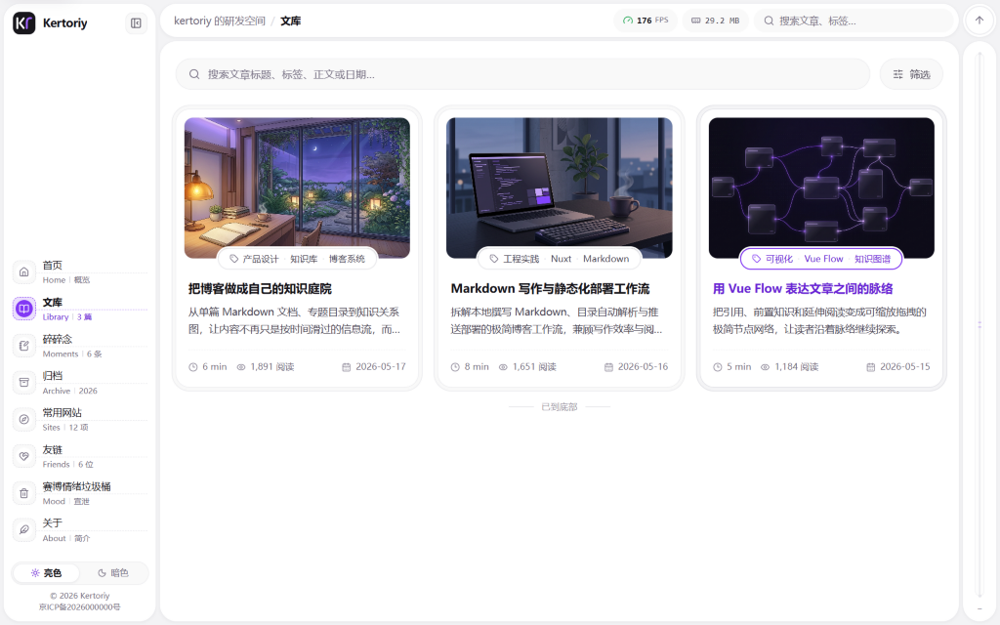
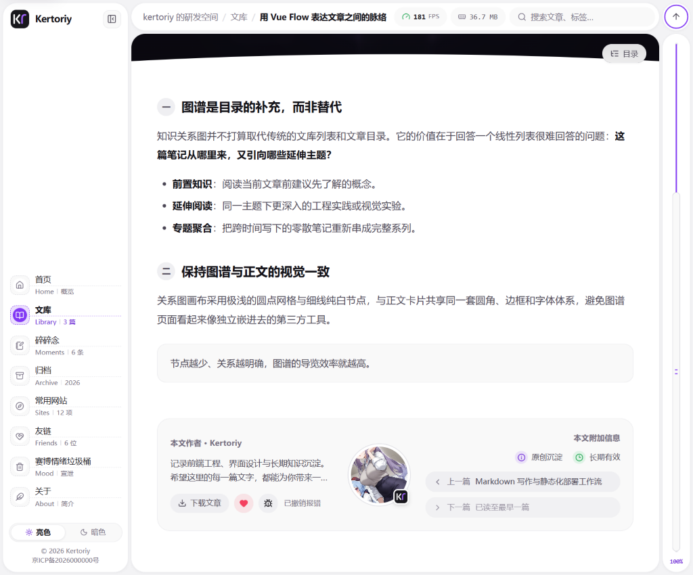
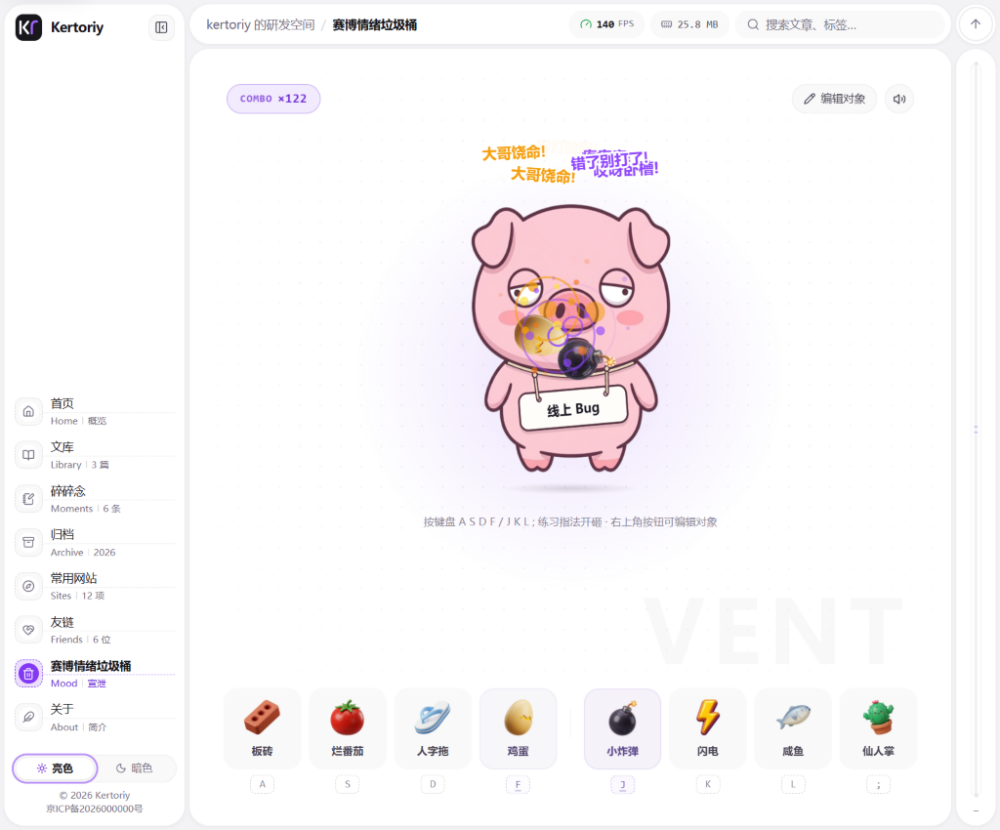
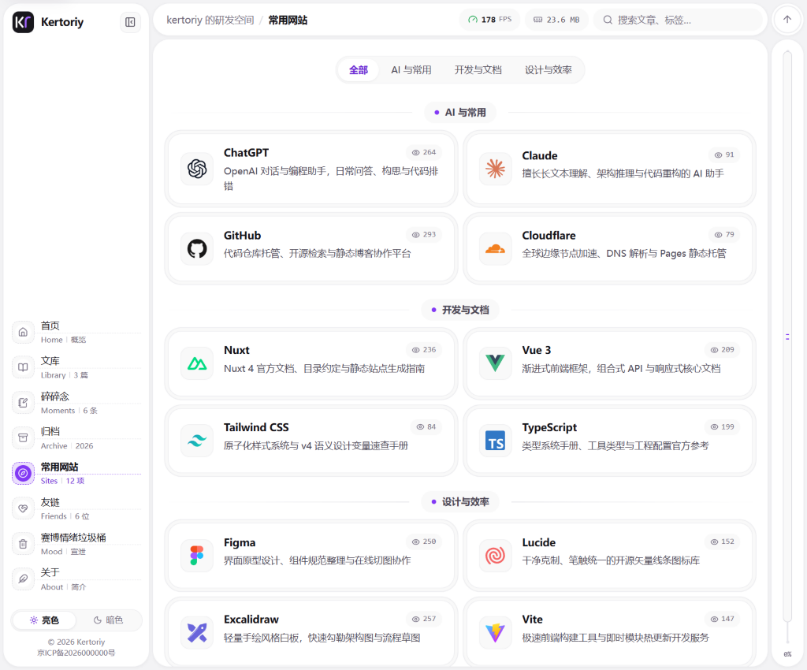

<div align="center">


<h1>kertoriy 的研发空间</h1>

<p>
  <strong>基于 Nuxt 4 · Vue 3 · Tailwind CSS v4 打造的零 UI 框架个人博客与知识庭院</strong>
</p>

<p>
  清透双主题 · 本地 Markdown / JSON 文件驱动 · Chart.js 数据看板 · 180 FPS Canvas 赛博情绪垃圾桶 · 静态预渲染零运维部署
</p>

<p>
  
  
  
  
  
  
  
  
</p>

<p>
  <a href="#-核心界面预览">界面预览</a> ·
  <a href="#-核心特性">核心特性</a> ·
  <a href="#-页面与路由">页面路由</a> ·
  <a href="#-内容维护指南">内容维护</a> ·
  <a href="#-快速开始">快速开始</a> ·
  <a href="#-部署指南">部署指南</a>
</p>

<br />

<picture>
  <source media="(prefers-color-scheme: dark)" srcset="./docs/preview/home-dark.png" />
  <source media="(prefers-color-scheme: light)" srcset="./docs/preview/home-light.png" />
  
</picture>

</div>

---

## ✨ 核心特性

- **零第三方 UI 框架**：不引入 Element Plus / Naive UI / Ant Design 等组件库，全部界面基于 **Tailwind CSS v4** 与语义化 CSS 变量手工打磨，轻盈克制、无企业后台感。
- **亮 / 暗双主题系统**：完整覆盖亮色清透风与 Kiro 风格暗色紫调（`#9147ff`），包括侧栏、外置 1:1 自定义滚动条、图表配色、代码与阅读器过渡。
- **全本地文件驱动**：零数据库、零 Docker、零 `.env` 即可运行；文章（`.md`）、碎碎念（`.txt`）、常用网站 / 友链 / 关于配置（`.json`）均集中在 `app/content/`，改文件即自动刷新与静态预渲染。
- **多维站点数据看板**：首页内置 3×2 实时统计卡片（访问、字数、运行时间、文库、碎碎念、友链）与三列 **Chart.js** 交互图表（近七日访问趋势、碎碎念标签/时间分布、文库/友链/字数分布），并联动真实 `package.json` 技术栈与版本墙。
- **沉浸式文章阅读体验**：全幅暗幕封面 + 柔和弧形画布衔接、内置 Web Speech API 语音朗读波形胶囊、灰圆中文序号（一、二、三）正文排版、吸顶悬浮目录，文末提供 **一键导出 Markdown（`.md`）** 与 **喜欢 / 报错** 轻互动反馈。
- **180 FPS 赛博情绪垃圾桶**：独立创意互动模块，采用 **Q 版呆傻小猪绕脖挂牌 + 8 键标准指法（`ASDF JKL;`）透明虚线键帽 + 单层 HiDPI Canvas 渲染引擎 + 复用 Web Audio「啪啪啪」拍打声总线**，双手极速狂按连击依然丝滑稳帧不卡顿。
- **交互式研发桌搭展示**：关于页提供 9 件真实硬件的桌面热区标注、纯净文字设备聚光灯与极简圆点轮播切换。

---

## 🖼️ 核心界面预览

### 1. 首页欢迎屏（亮色 / 暗色双主题对比）

全幅透明立绘叠加极淡水印与柔和紫晕，搭配实时运行时间状态胶囊、顶栏 FPS / 内存遥测与外置自定义滚动条。

<table>
  <tr>
    <td width="50%" align="center">
      
      <br />
      <sub><strong>亮色模式</strong> · 清透柔和纸感画布</sub>
    </td>
    <td width="50%" align="center">
      
      <br />
      <sub><strong>暗色模式</strong> · 深邃暗紫与标志紫强调</sub>
    </td>
  </tr>
</table>

### 2. 站点统计看板、最近文章与技术栈版本墙

3×2 统计卡片与三列 Chart.js 交互分布图同轴对齐；文章卡片悬浮呈现对称渐进闭合描边；底部自动读取 `package.json` 展示本站技术栈与真实版本号。

<table>
  <tr>
    <td width="50%" align="center">
      
      <br />
      <sub><strong>站点统计</strong> · 3×2 KPI 指标 + 三列 Chart.js 分布图</sub>
    </td>
    <td width="50%" align="center">
      
      <br />
      <sub><strong>最近文章 & 技术栈</strong> · 对称闭合标签描边 + 官方品牌图标</sub>
    </td>
  </tr>
</table>

### 3. 文库与沉浸式文章阅读器

文库支持实时关键字检索、标签筛选与阅读量持久化累计；文章正文采用全幅氛围封面与灰圆中文序号排版，文末集成 **下载文章（`.md`）**、**喜欢**、**报错** 与上下篇导览。

<table>
  <tr>
    <td colspan="2" align="center">
      
      <br />
      <sub><strong>文库列表</strong> · 图文卡片网格 + 单层边框对称闭合紫框标签 + 实时阅读计数</sub>
    </td>
  </tr>
  <tr>
    <td width="50%" align="center">
      
      <br />
      <sub><strong>文章封面与正文</strong> · 语音朗读胶囊 + 吸顶目录 + 灰圆中文序号</sub>
    </td>
    <td width="50%" align="center">
      
      <br />
      <sub><strong>文末作者卡片</strong> · Markdown 一键下载 + 喜欢 / 报错轻互动 + 上下篇导览</sub>
    </td>
  </tr>
</table>

### 4. 赛博情绪垃圾桶（180 FPS Canvas · 标准指法解压）

右上角可随时唤出 IP 下方独立胶囊编辑台实时同步挂牌对象；支持双手按键盘标准基准键位 **`A S D F` / `J K L ;`** 极速盲打抛掷 8 种情绪道具，单层 Canvas + 布局坐标缓存 + Web Audio 滤波总线保证狂按稳帧。

<div align="center">
  
  <br />
  <sub><strong>赛博情绪垃圾桶</strong> · Q 版呆傻小猪绕脖牌 · 8 键 <code>ASDF JKL;</code> 虚线键帽 · 常驻 <code>COMBO</code> · 180 FPS Canvas 特效</sub>
</div>

### 5. 关于页 ·「开发 の 设备」交互式研发桌搭

点击桌面实景中的 9 个硬件热区或下方极简圆点，即可切换查看主力笔电、白色全塔工作站、双 2K 显示器、外设与影音设备配置。

<div align="center">
  
  <br />
  <sub><strong>开发 の 设备</strong> · 9 处硬件交互热区 + 纯净文字聚光灯 + 极简分页圆点</sub>
</div>

### 6. 常用网站 · 友链 · 碎碎念 · 归档

<table>
  <tr>
    <td width="50%" align="center">
      
      <br />
      <sub><strong>常用网站</strong> · 分组导航 + 实时访问次数统计</sub>
    </td>
    <td width="50%" align="center">
      
      <br />
      <sub><strong>友链</strong> · 极简无边框友链申请 + 两步预览生成 JSON + 交流群二维码</sub>
    </td>
  </tr>
  <tr>
    <td width="50%" align="center">
      
      <br />
      <sub><strong>碎碎念</strong> · 纯文本文件驱动时间流 + 分类水印卡片</sub>
    </td>
    <td width="50%" align="center">
      
      <br />
      <sub><strong>归档</strong> · 按年份与月份自动聚合的时间线清单</sub>
    </td>
  </tr>
</table>

---

## 🗺️ 页面与路由

| 路由 | 模块 | 核心功能 |
| :--- | :--- | :--- |
| `/` | 首页 | 全幅刻晴欢迎屏、实时运行时间、3×2 站点统计、三列 Chart.js 分布图、最近文章、技术栈版本墙 |
| `/library` | 文库 | 图文文章卡片、标题/标签/正文搜索、分类筛选、单层闭合描边标签动效、阅读量统计 |
| `/library/[slug]` | 文章详情 | 暗幕封面头图、Web Speech 语音朗读、吸顶目录、中文序号正文、Markdown 下载、喜欢/报错轻互动 |
| `/notes` | 碎碎念 | 按 `YYYY-MM-DD-标签.txt` 自动解析的短记流，支持按标签筛选与渐进加载 |
| `/archive` | 归档 | 按年份聚合文章时间线与总字数统计 |
| `/sites` | 常用网站 | 分组工具导航、矢量品牌图标、点击自动累加并持久化访问次数 |
| `/friends` | 友链 | 友链卡片分组、一键复制站点头像/信息/JSON、两步式友链申请预览弹窗、交流群二维码 |
| `/trash` | 赛博情绪垃圾桶 | Q 版小猪绕脖挂牌、独立实时编辑台、`ASDF JKL;` 8 键盲打抛掷、180 FPS Canvas 特效与统一拍打音效 |
| `/about` | 关于 | 个人档案、9 件真实研发桌搭交互展示、常用技术栈、喜欢的游戏与多渠道联系方式 |

---

## 🛠️ 技术栈

| 分类 | 技术 / 依赖 | 版本 | 用途 |
| :--- | :--- | :---: | :--- |
| 应用框架 | **Nuxt** | `4.4.5` | 全栈目录约定、自动导入与静态预渲染 |
| 视图层 | **Vue** | `3.5.34` | Composition API、`<script setup>` 响应式界面 |
| 路由 | **Vue Router** | `5.0.6` | 页面导航与动态文章路由 |
| 样式引擎 | **Tailwind CSS** | `4.3.0` | 原子化样式 + `@theme` 亮/暗语义变量 |
| 构建工具 | **Vite / Nitro** | `7.3` / `2.13` | 极速热更新与静态产物生成 |
| 数据可视化 | **Chart.js** | `4.6.1` | 折线趋势图、环形分布图与柱状时间分布图 |
| 图标库 | **lucide-vue-next** | `1.0.0` | 全站统一线条矢量图标 |
| 扩展能力预留 | **Vue Flow / Tiptap** | `1.48` / `3.23` | 知识关系图谱与所见即所得编辑器演进依赖 |

---

## 📁 目录结构

```txt
ker-edit-blog/
├── app/
│   ├── assets/css/          # 按模块拆分的 Tailwind CSS v4 样式表
│   ├── components/          # 侧栏、首页统计图表、文章阅读器、标签蜂巢等组件
│   ├── composables/         # 主题切换、站点/文章/网站计数、FPS/内存遥测、滚动加载
│   ├── content/             # 全站内容数据源（改动即生效，无需改组件代码）
│   │   ├── articles/*.md    #   Markdown 文章正文与 YAML Frontmatter
│   │   ├── notes/*.txt      #   碎碎念纯文本（命名格式：YYYY-MM-DD-标签.txt）
│   │   ├── site.json        #   站点名称、域名、头像、运行起点与备案配置
│   │   ├── sites.json       #   常用网站分组与站点清单
│   │   ├── friends.json     #   友链列表与分组
│   │   └── about.json       #   关于页档案、研发桌搭设备、技术栈、游戏与联系方式
│   ├── layouts/default.vue  # 桌面侧栏 + 顶栏面包屑 + 外置自定义滚动条 + 移动抽屉
│   ├── pages/               # 所有前台页面路由
│   └── utils/               # Markdown 解析器、文章索引与内容加载工具
├── docs/preview/            # README 界面展示高清截图
├── public/                  # 封面图、立绘、桌搭设备图、品牌 SVG 图标、情绪道具 PNG
├── server/api/              # 服务端健康检查与后续后台 API 预留目录
├── Dockerfile               # Node 22 静态预渲染 + Caddy 2 Alpine 多阶段构建
├── Caddyfile                # Caddy 2 静态托管、缓存策略、Zstd/Gzip 与自动 HTTPS 配置
├── docker-compose.yml       # 一键 Caddy 容器编排（含证书持久化卷与健康检查）
├── .env.example             # Docker + Caddy 部署环境变量模板
├── LICENSE                  # MIT 开源协议
└── .github/workflows/       # GitHub Pages 自动静态构建与发布工作流
```

---

## 📝 内容维护指南

站点所有展示内容均由 `app/content/` 下的纯文件维护，由 `app/utils/content.ts` 与 `app/utils/articles.ts` 统一自动扫描加载：

- **新增文章**：在 `app/content/articles/` 下新建 `your-slug.md`，顶部编写 Frontmatter 即可自动出现在首页、文库、归档与静态预渲染路由中：
  ```markdown
  ---
  title: 文章标题
  slug: your-slug
  date: 2026-05-18
  category: 工程实践
  tags: [Nuxt, Vue]
  cover: covers/your-cover.jpg
  summary: 一句话摘要说明。
  ---

  ## 正文二级标题

  正文内容……
  ```
- **新增碎碎念**：在 `app/content/notes/` 下新建 `YYYY-MM-DD-标签.txt`（支持标签：`随想`、`折腾`、`灵感`、`日常`，同日多条可追加 `-2` 序号），正文直接写纯文本，空行自动分段。
- **更新导航 / 友链 / 关于 / 站点配置**：分别编辑 `sites.json`、`friends.json`、`about.json`、`site.json`。

---

## 🚀 快速开始

环境要求：**Node.js 22+** 与 **pnpm 10+**（当前版本无需数据库、Docker 或环境变量配置）。

```bash
# 1. 安装依赖
pnpm install

# 2. 启动本地开发服务（默认 http://localhost:3000）
pnpm dev

# 3. 静态预渲染打包（产物输出至 .output/public）
pnpm generate

# 4. 本地预览静态打包结果
pnpm preview
```

---

## ☁️ 部署指南

### 方式一：Docker Compose + Caddy 自托管部署（推荐 VPS / 独立域名）

仓库内置多阶段 [Dockerfile](./Dockerfile)（`node:22-alpine` 静态预渲染 → 极简 `caddy:2-alpine` 托管）、[Caddyfile](./Caddyfile) 与 [docker-compose.yml](./docker-compose.yml)，支持自动 Zstd/Gzip 压缩、分级缓存与 Let's Encrypt 自动 HTTPS。

```bash
# 1. 复制环境变量模板
cp .env.example .env

# 2. 按场景修改 .env：
#    - 本地/测试 HTTP 预览：SITE_ADDRESS=:80，HTTP_PORT=8080
#    - 生产域名自动 HTTPS：SITE_ADDRESS=kertoriy.dev，HTTP_PORT=80，HTTPS_PORT=443

# 3. 构建并后台启动 Caddy 容器
docker compose up -d --build
```

> 修改内容后重新执行 `docker compose up -d --build` 即可无感更新；`caddy_data` 与 `caddy_config` 命名卷会自动持久化已签发的 TLS 证书。

### 方式二：GitHub Pages 自动部署

仓库已内置 [GitHub Pages 自动部署工作流](./.github/workflows/deploy.yml)：

1. 推送代码至 `main` 分支（或手动触发 `workflow_dispatch`）；
2. GitHub Actions 自动执行 `pnpm install --frozen-lockfile` 与 `pnpm generate`；
3. 将 `.output/public` 静态预渲染产物自动发布到 GitHub Pages。

> 若绑定自定义根域名（例如 `https://kertoriy.dev`）或部署到 `<username>.github.io` 根路径，将 `.github/workflows/deploy.yml` 中的 `NUXT_APP_BASE_URL` 改为 `/` 即可。

---

## 📄 开源协议

本项目基于 [MIT License](./LICENSE) 开源。

---

<details>
<summary><strong>📌 后续演进规划（点击展开查看全栈化与后台规划摘要）</strong></summary>

当前阶段已完成全部前台核心阅读体验、统计看板、文件驱动与创意互动模块；后续若升级为动态全栈知识库系统，规划方向如下（详见 [AGENTS.md](./AGENTS.md)）：

- **前后台一体编辑体验**：保留与前台一致的视觉标准，集成 **Tiptap** 所见即所得编辑器与自定义语法扩展，支持类飞书/语雀的实时渲染创作。
- **知识关系图谱**：基于 **Vue Flow** 可视化文章、专题、标签与前置/延伸阅读之间的知识脉络。
- **混合存储与鉴权**：MySQL（元信息/关系边/长期聚合统计）+ MongoDB（正文块与历史版本）+ Redis（实时计数/会话/限流），单管理员环境变量哈希密码 + HttpOnly Cookie 鉴权，腾讯云 COS 对象存储。

</details>

---

<div align="center">
  <sub>Made with ❤️ by <strong>Kertoriy</strong> · Powered by Nuxt 4 & Tailwind CSS v4</sub>
</div>
