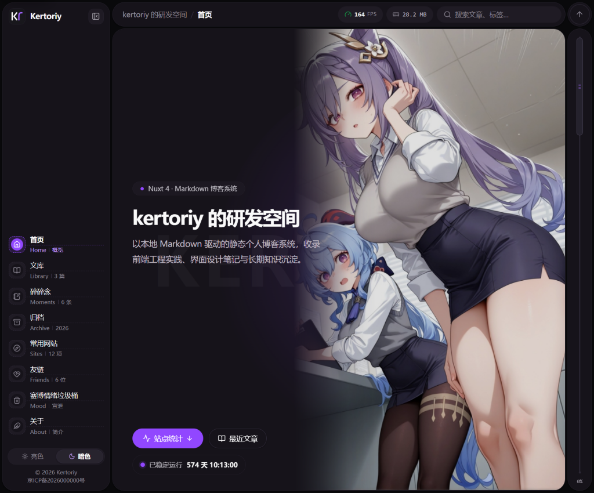
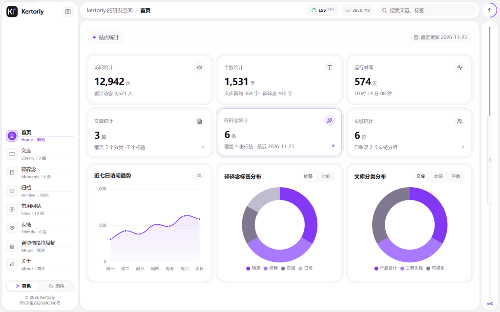
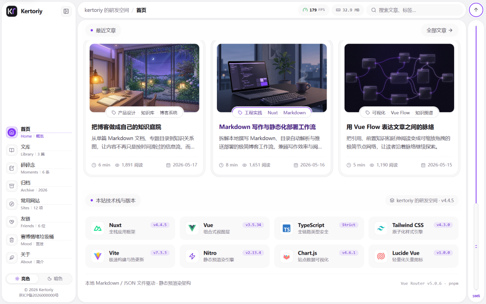
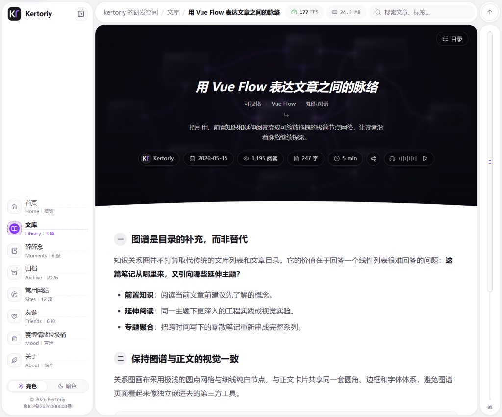
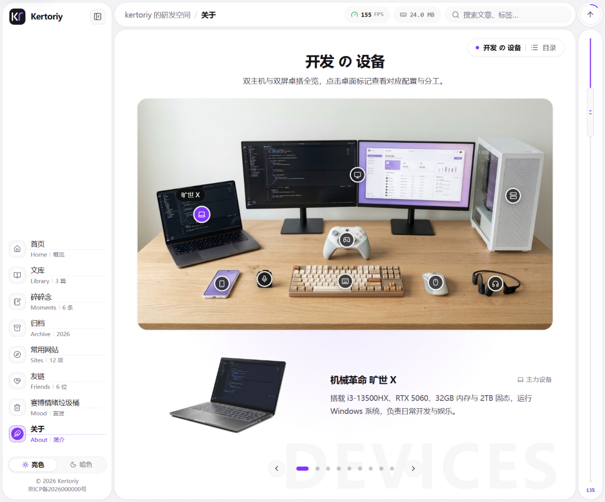
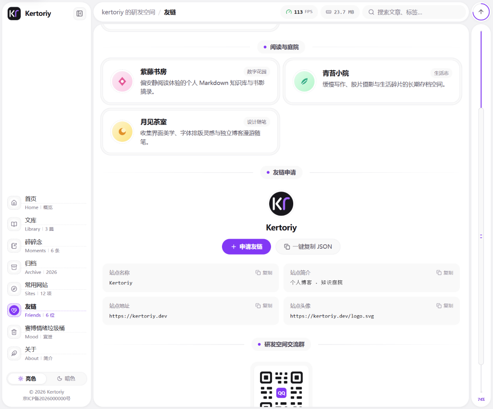
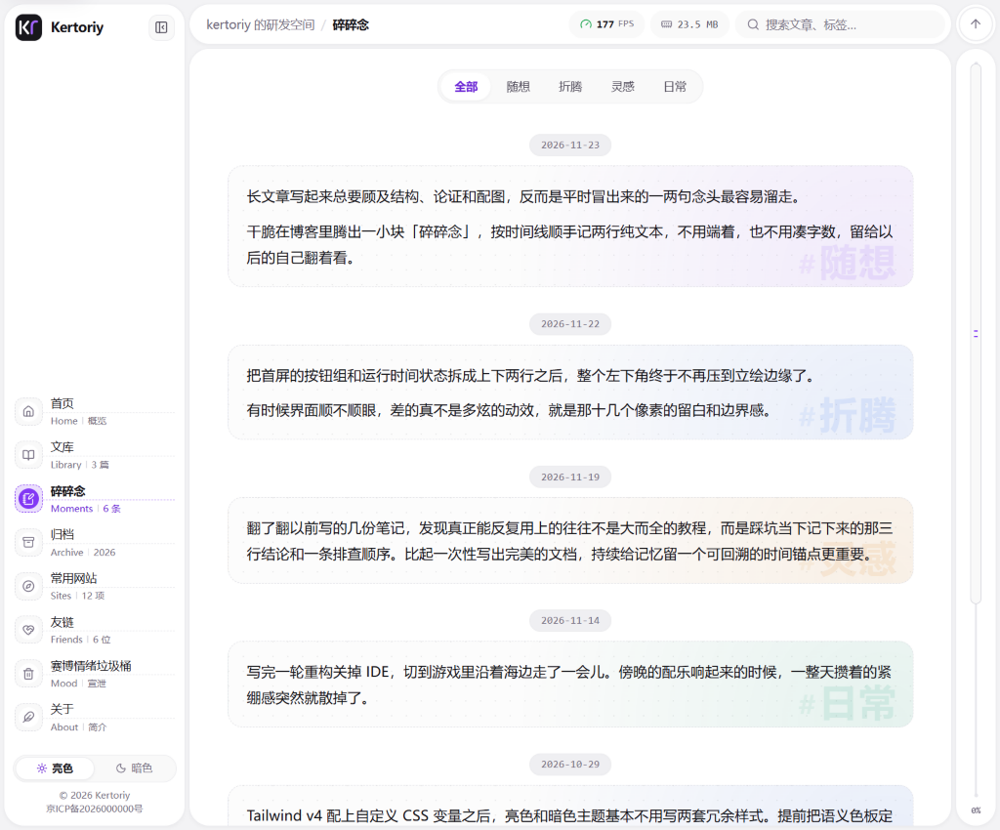
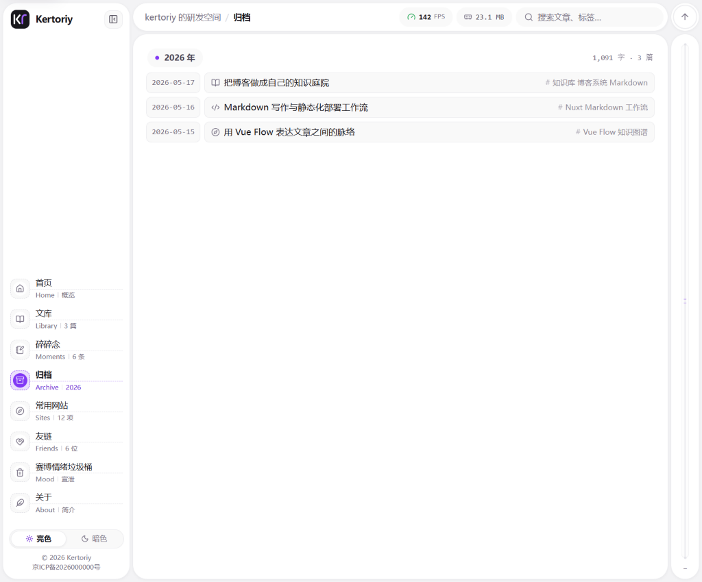

<div align="center">


<h1>kertoriy 的研发空间</h1>

<p>个人静态博客源码，基于 Nuxt 4、Vue 3 和 Tailwind CSS v4 编写，使用本地文件维护内容。</p>

<p>
  线上地址：<a href="https://kertoriy.cn">https://kertoriy.cn</a>
</p>

<p>
  
  
  
  
  
</p>

<br />

<picture>
  <source media="(prefers-color-scheme: dark)" srcset="./docs/preview/home-dark.png" />
  <source media="(prefers-color-scheme: light)" srcset="./docs/preview/home-light.png" />
  
</picture>

</div>

---

## 页面预览

<table>
  <tr>
    <td width="50%" align="center">
      
      <br />
      <sub>首页（亮色）</sub>
    </td>
    <td width="50%" align="center">
      
      <br />
      <sub>首页（暗色）</sub>
    </td>
  </tr>
  <tr>
    <td width="50%" align="center">
      
      <br />
      <sub>站点统计与 Chart.js 分布图</sub>
    </td>
    <td width="50%" align="center">
      
      <br />
      <sub>最近文章与技术栈版本</sub>
    </td>
  </tr>
  <tr>
    <td width="50%" align="center">
      
      <br />
      <sub>文库列表与检索</sub>
    </td>
    <td width="50%" align="center">
      
      <br />
      <sub>文章正文、目录与语音朗读</sub>
    </td>
  </tr>
  <tr>
    <td width="50%" align="center">
      
      <br />
      <sub>文末 Markdown 下载、喜欢 / 报错与上下篇</sub>
    </td>
    <td width="50%" align="center">
      
      <br />
      <sub>赛博情绪垃圾桶（ASDF / JKL; 键盘互动）</sub>
    </td>
  </tr>
  <tr>
    <td width="50%" align="center">
      
      <br />
      <sub>关于页 · 开发设备与桌面热区</sub>
    </td>
    <td width="50%" align="center">
      
      <br />
      <sub>常用网站与访问计数</sub>
    </td>
  </tr>
  <tr>
    <td width="50%" align="center">
      
      <br />
      <sub>友链、友链申请与交流群</sub>
    </td>
    <td width="50%" align="center">
      
      <br />
      <sub>碎碎念</sub>
    </td>
  </tr>
</table>

<details>
<summary>查看更多截图（归档页）</summary>
<br />

</details>

---

## 页面结构

| 路由 | 页面 | 说明 |
| :--- | :--- | :--- |
| `/` | 首页 | 欢迎屏、站点运行时间、统计指标与 Chart.js 图表、最近文章、技术栈版本 |
| `/library` | 文库 | 文章列表、搜索与标签筛选、阅读计数 |
| `/library/[slug]` | 文章详情 | Markdown 正文渲染、悬浮目录、语音朗读、导出 `.md`、喜欢 / 报错记录 |
| `/notes` | 碎碎念 | 按时间倒序展示的短文本记录与标签筛选 |
| `/archive` | 归档 | 按年份整理的文章时间线 |
| `/sites` | 常用网站 | 分组整理的工具链接与点击访问次数 |
| `/friends` | 友链 | 友链展示、信息复制、两步申请弹窗与交流群二维码 |
| `/trash` | 赛博情绪垃圾桶 | Canvas 抛掷动画、对象名挂牌、键盘 `A S D F` / `J K L ;` 触发 |
| `/about` | 关于 | 个人简介、设备桌搭、技术栈、游戏与联系方式 |

---

## 技术栈

不使用第三方 UI 组件库，样式通过 Tailwind CSS v4 与 CSS 变量编写，图标使用 `lucide-vue-next`，图表使用 `chart.js`。

- **Nuxt** `4.4.5` / **Vue** `3.5.34` / **Vue Router** `5.0.6`
- **Tailwind CSS** `4.3.0` / **TypeScript**
- **Chart.js** `4.6.1` / **lucide-vue-next** `1.0.0`

---

## 内容维护

站点不依赖数据库，全部内容保存在 `app/content/` 目录，由 `app/utils/content.ts` 和 `app/utils/articles.ts` 加载：

```txt
app/content/
├── articles/*.md   # 文章正文与 Frontmatter（title / slug / date / category / tags / cover / summary）
├── notes/*.txt     # 碎碎念，文件名格式为 YYYY-MM-DD-标签.txt（标签：随想 / 折腾 / 灵感 / 日常）
├── site.json       # 站点名称、线上域名、头像、运行起点与备案信息
├── sites.json      # 常用网站分组与链接
├── friends.json    # 友链数据
└── about.json      # 关于页资料、设备、技术栈、游戏与联系方式
```

---

## 本地开发

需要 Node.js 22+ 和 pnpm 10+：

```bash
pnpm install
pnpm dev
```

访问 `http://localhost:3000`。静态构建与预览：

```bash
pnpm generate
pnpm preview
```

---

## 部署（Docker Compose + Caddy）

项目包含多阶段 [Dockerfile](./Dockerfile)（构建静态产物并交由 `caddy:2-alpine` 托管）、[Caddyfile](./Caddyfile) 与 [docker-compose.yml](./docker-compose.yml)：

```bash
cp .env.example .env
# 生产环境将 .env 中的 SITE_ADDRESS 设为 kertoriy.cn，HTTP_PORT=80，HTTPS_PORT=443
docker compose up -d --build
```

Caddy 会自动处理 `https://kertoriy.cn` 的 HTTPS 证书签发与续期，证书保存在 `caddy_data` 卷中。

---

## License

[MIT](./LICENSE)
